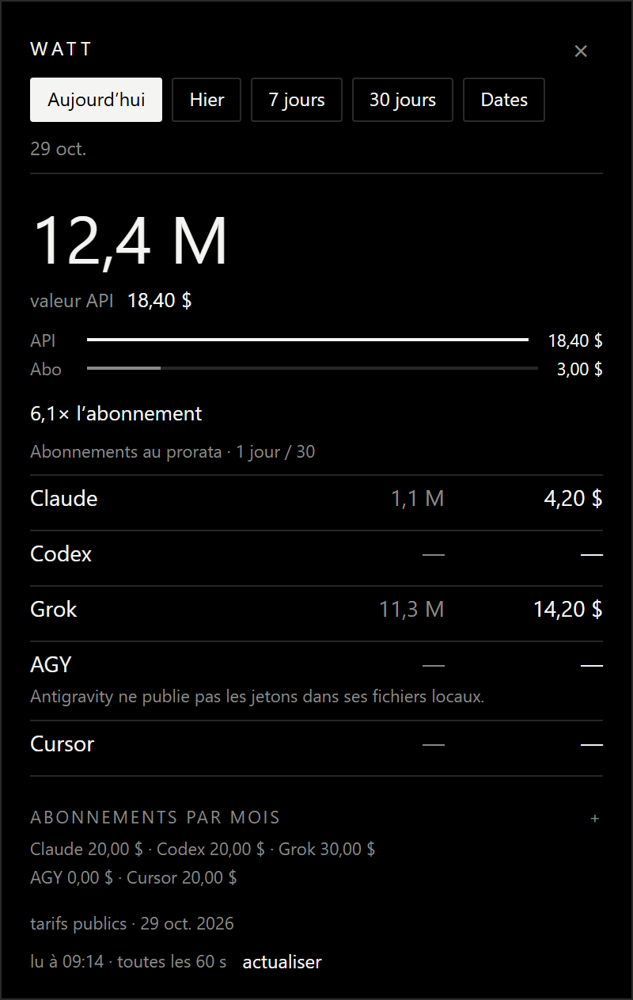

# Watt

Compteur de jetons dans la barre des tâches.

[](https://github.com/mnkz/watt/actions/workflows/ci.yml)



Chiffres d’exemple. Claude, Codex, Grok et Cursor sont lus dans les journaux déjà sur la machine. Antigravity a sa ligne : ses fichiers ne publient pas de compteurs. Watt ne garde que les volumes, le modèle et le prix.

| | |
| --- | --- |
| Claude | `~/.claude/projects/**/*.jsonl`, le `usage` de chaque réponse. Cache lu, écriture 5 min et écriture 1 h séparés. |
| Codex | `~/.codex/sessions/**/*.jsonl`, uniquement `token_usage_record`. |
| Grok | `~/.grok/logs/unified.jsonl`, événements `shell.turn.inference_done`, dédoublonnés. |
| Cursor | `%APPDATA%\Cursor\User\globalStorage\state.vscdb`, bulles assistant. La date est l’ouverture de la session, le modèle n’est pas nommé, le tarif est indicatif. |
| AGY | conversations Antigravity, sans compteur. La ligne reste vide. |

Un fournisseur qui range déjà le cache dans le prompt n’est pas compté deux fois. Le contexte long, Codex au-delà de 272 k et Grok au-delà de 200 k, est tarifé appel par appel. La grille est dans `src/price.rs`, datée du 29 oct. 2026 à l’écran.

L’abonnement est un montant saisi, proratisé par `montant × jours / 30`. Défauts au premier lancement : Claude 20 $, Codex 20 $, Grok 30 $, AGY 0 $, Cursor 20 $. Ils restent dans `%LOCALAPPDATA%\Watt\config.json`.

La première lecture peut traverser plusieurs gigaoctets. Ensuite `%LOCALAPPDATA%\Watt\cache.json` ne reprend que les lignes nouvelles, environ toutes les 60 secondes.

Cinq périodes : aujourd’hui, hier, 7 jours, 30 jours, ou deux dates. Échap ou la croix cache la fenêtre. Le clic droit sur l’icône propose Quitter. `--tray` démarre dans la zone de notification.

## Compiler

Rust édition 2024, Windows.

```
cargo build --release
```

L’exécutable est `target\release\watt.exe`. Une seconde copie se retire.

```powershell
$s = (New-Object -ComObject WScript.Shell).CreateShortcut(
  "$env:APPDATA\Microsoft\Windows\Start Menu\Programs\Startup\Watt.lnk")
$s.TargetPath = "$PWD\target\release\watt.exe"
$s.Arguments = "--tray"
$s.WorkingDirectory = "$PWD"
$s.WindowStyle = 7
$s.Save()
```

[MIT](LICENSE).
