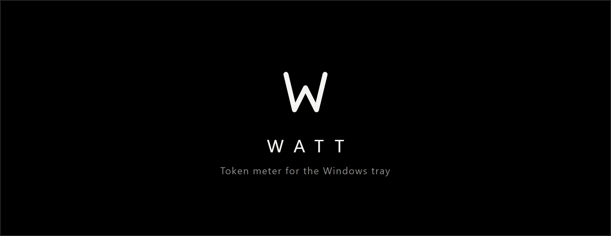
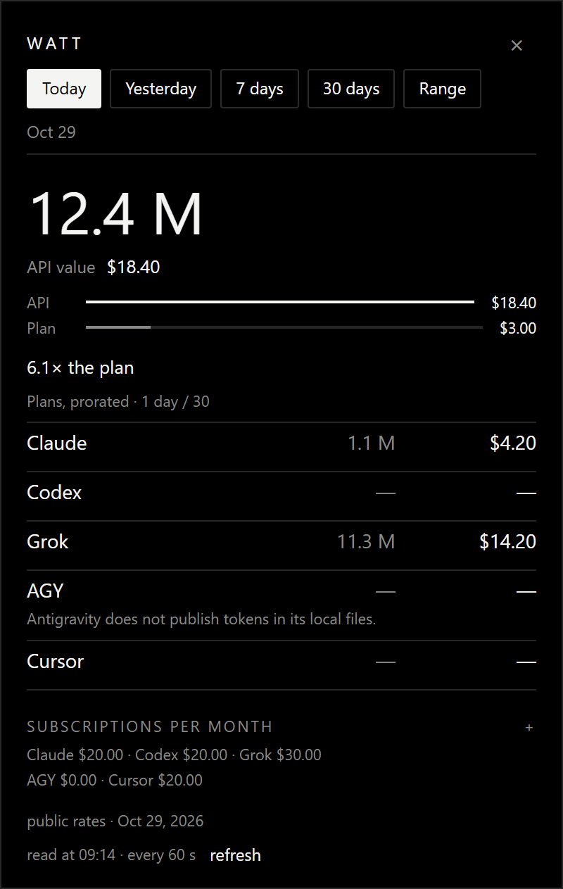

<p align="center">
  
</p>

<p align="center">
  <a href="https://github.com/mnkz/watt/actions/workflows/ci.yml"></a>
  
  
</p>

Watt lives in the notification area. It reads the token journals already on the machine, prices them at public list rates, and sets that figure next to the subscription you typed in.

<p align="center">
  
</p>

Example figures. The mark is [`docs/mark.svg`](docs/mark.svg).

## Where the numbers come from

| | |
| --- | --- |
| Claude | `~/.claude/projects/**/*.jsonl`, the `usage` of each reply. Cache reads and 5-minute / 1-hour writes are kept apart. |
| Codex | `~/.codex/sessions/**/*.jsonl`, only `token_usage_record`. |
| Grok | `~/.grok/logs/unified.jsonl`, `shell.turn.inference_done` events, deduped. |
| Cursor | `%APPDATA%\Cursor\User\globalStorage\state.vscdb`, assistant bubbles. The date is the session start. The model is not named, so the rate is indicative. |
| AGY | Antigravity conversations, with no token counters. The row stays empty. |

A provider that already folds cache into the prompt is not counted twice. Long context, Codex past 272k and Grok past 200k, is priced per call. The card is in `src/price.rs`, labeled Oct 29, 2026 on screen.

The subscription is a number you set, prorated as `amount × days / 30`. First-launch defaults: Claude $20, Codex $20, Grok $30, AGY $0, Cursor $20. They stay in `%LOCALAPPDATA%\Watt\config.json`.

The first read can walk several gigabytes. After that, `%LOCALAPPDATA%\Watt\cache.json` picks up only the new lines, about every 60 seconds.

Five ranges: today, yesterday, 7 days, 30 days, or two dates. Escape or the close mark hides the window. Right-click the icon for Quit. `--tray` starts in the notification area.

## Build

Rust edition 2024, Windows.

```
cargo build --release
```

The binary is `target\release\watt.exe`. A second copy steps aside.

```powershell
$s = (New-Object -ComObject WScript.Shell).CreateShortcut(
  "$env:APPDATA\Microsoft\Windows\Start Menu\Programs\Startup\Watt.lnk")
$s.TargetPath = "$PWD\target\release\watt.exe"
$s.Arguments = "--tray"
$s.WorkingDirectory = "$PWD"
$s.WindowStyle = 7
$s.Save()
```

[MIT](LICENSE).
